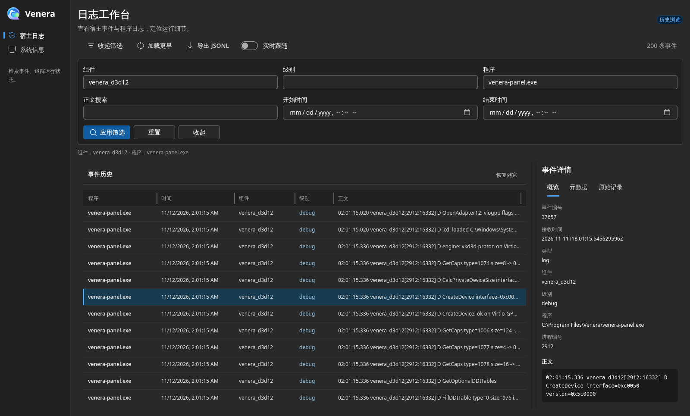
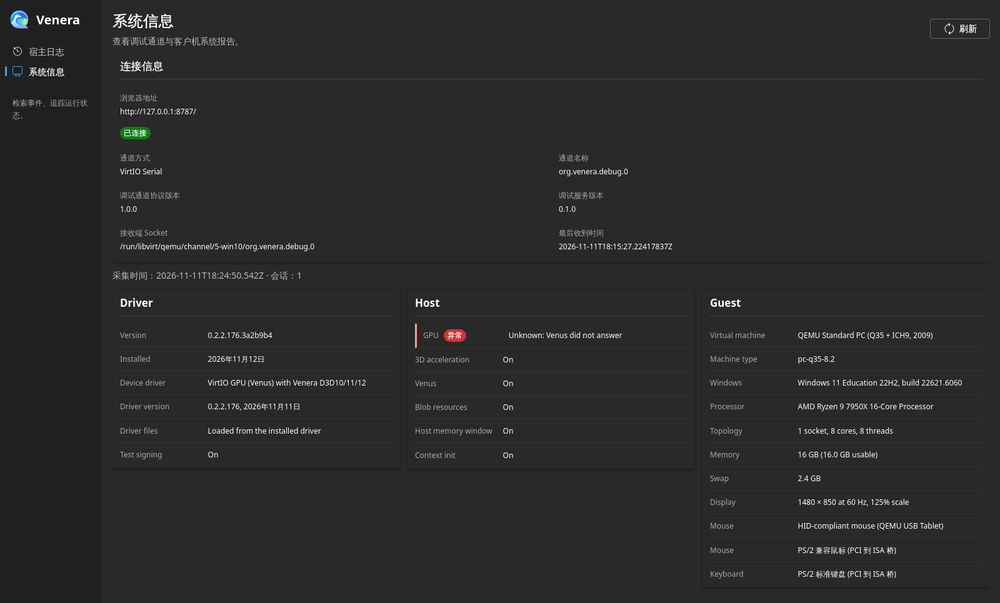

# Venera 宿主调试记录

宿主后台持续接收 QEMU 调试端口的记录，保存来宾日志、有效筛选、连接变化与通道诊断。历史按接收顺序保存在 SQLite，容量达到预算后淘汰最旧记录。日志等级保留采集端提供的原始值与归一化值。

## 构建与运行

```sh
cd debug-channel
cargo build --release -p venera-debug-host
```

QEMU 为专用 virtserialport 提供 Unix socket listener，后台连接该路径并持续重连：

```sh
venera-debug-host receive \
  --socket /run/user/1000/venera-debug.sock \
  --control /run/user/1000/venera-control.sock \
  --database /home/user/.local/share/venera/history.db \
  --max-bytes 1073741824
```

先创建示例中的历史目录，并将路径替换为当前用户的实际路径。`receive` 持续运行，可交由 `systemd --user` 托管。每次连接建立后，后台发送端点介绍及状态查询。

`--max-bytes` 是历史库与 SQLite 工作空间的总容量预算，最小值为 65536 字节；其中预留事务工作空间，历史数据使用其余容量。历史按最旧记录分批淘汰，并在提交时回收数据库页。存储错误通过后台运行诊断报告。

## 用户服务部署

从仓库根目录运行，选择可访问的 QEMU socket 路径。以下命令将编译产物放在用户程序目录，并渲染服务模板中的启动命令：

```sh
nix develop --command cargo build --manifest-path debug-channel/Cargo.toml --release -p venera-debug-host
install -Dm755 debug-channel/target/release/venera-debug-host "$HOME/.local/bin/venera-debug-host"
mkdir -p "$HOME/.local/share/venera" "$XDG_RUNTIME_DIR/venera"
python3 scripts/venera-debug-host-service \
  --binary "$HOME/.local/bin/venera-debug-host" \
  --socket "$XDG_RUNTIME_DIR/venera/debug.sock" \
  --control "$XDG_RUNTIME_DIR/venera/control.sock" \
  --database "$HOME/.local/share/venera/history.db" \
  --max-bytes 1073741824 \
  --output "$HOME/.config/systemd/user/venera-debug-host.service"
systemd-analyze --user verify "$HOME/.config/systemd/user/venera-debug-host.service"
systemctl --user daemon-reload
systemctl --user enable --now venera-debug-host.service
systemctl --user status venera-debug-host.service
journalctl --user -u venera-debug-host.service -f
```

模板位于 `debug-channel/host/systemd/venera-debug-host.service.in`。脚本接受安装后的绝对路径，将路径转换为 systemd 参数格式；服务发生运行故障时由用户服务管理器重启。服务管理器创建 `$XDG_RUNTIME_DIR/venera` 运行目录；若 QEMU 使用持久目录，将 `--socket` 和 `--control` 换成对应目录中的路径。

```sh
systemctl --user stop venera-debug-host.service
systemctl --user start venera-debug-host.service
"$HOME/.local/bin/venera-debug-host" status --control "$XDG_RUNTIME_DIR/venera/control.sock"
```

停止服务由服务管理器发送终止信号；已提交历史在下次启动时继续使用。用户服务随用户服务管理器生命周期运行，需要开机后持续运行的部署可由管理员为该用户配置 lingering。

## QEMU 与 libvirt 端口

QEMU 命令示例，在虚拟机已有 virtio-serial 控制器时使用其总线名称：

```sh
-chardev socket,id=venera-debug,path=/run/user/1000/venera/debug.sock,server=on,wait=off \
-device virtserialport,bus=virtio-serial0.0,chardev=venera-debug,name=org.venera.debug.0
```

为使用 libvirt 的虚拟机，在现有 `<devices>` 中追加以下 channel；路径应与宿主 `--socket` 一致，并允许 QEMU 运行用户和宿主后台用户访问：

```xml
<channel type='unix'>
  <source mode='bind' path='/run/user/1000/venera/debug.sock'/>
  <target type='virtio' name='org.venera.debug.0'/>
</channel>
```

libvirt 的 `bind` 模式创建监听 socket，QEMU 启动后等待后台连接；命令行形式对应 `server=on,wait=off`。现有 SPICE channel 和其他设备与新增 channel 一同保留，由 libvirt 分配空闲 virtio-serial 端口。系统 libvirt 常使用 `/var/lib/libvirt/qemu/channel/target/` 下的域专属目录；实际 socket 目录及访问权限按当前域的运行用户配置。域配置保存后，在计划的虚拟机重启中启用端口。

## 查询与筛选

```sh
venera-debug-host status --control /run/user/1000/venera-control.sock
venera-debug-host filter-set --control /run/user/1000/venera-control.sock \
  --filter '{"components":["dxvk"],"levels":["warning","error"],"targets":[]}' \
  --duration-ms 60000
venera-debug-host filter-reset --control /run/user/1000/venera-control.sock
```

命令向持续运行的后台提交请求，后台转交来宾并返回对应响应。响应中的有效筛选、修订号、到期时间及转发状态来自来宾。`status` 查询当前有效状态。

筛选对已经产生的记录进行选择。组件、等级和目标三个维度取交集，同一维度内取并集；空数组匹配该维度全部值。默认筛选的三个数组均为空。目标支持进程实例及可执行文件完整路径。

## 保存导出

```sh
venera-debug-host export --database /home/user/.local/share/venera/history.db \
  > session.jsonl
```

按宿主接收时间选择导出范围：

```sh
venera-debug-host export --database /home/user/.local/share/venera/history.db \
  --from 2026-11-10T08:00:00Z --until 2026-11-10T09:00:00Z \
  > session-hour.jsonl
```

`--from` 包含起点，`--until` 在终点前截止；两者可单独使用。时间使用 RFC3339，支持小数秒和时区偏移，按对应 UTC 时刻比较。范围同时适用于日志、状态、连接及缺口记录，以宿主 `received_at` 为准。两个参数同时提供时，起点应早于终点。默认导出当前全部历史。

导出逐行生成 JSON，每行包含宿主接收 UTC 时间 `received_at` 与原始消息对象 `message`，保留消息的附加字段。导出开始时确定末尾位置，按接收顺序逐条读取当时仍保留的历史；后台在导出期间继续接收和淘汰，读取到某条记录之前已被淘汰的历史会跳过。入库编号持久递增，导出的截止位置对应开始时的历史批次。需要完整保存某个当前历史批次时，先停止服务，再运行导出。用户保存的文件独立于后台历史容量维护。

## 浏览器日志工作台

工作台提供历史浏览、实时跟随、全文搜索和记录详情。可按组件、消息级别、程序路径或 PID，以及接收时间范围筛选历史，再将当前条件匹配的记录导出为 JSONL。记录详情显示完整正文、程序信息和原始记录。

构建宿主程序与前端：

```sh
# 从仓库根目录运行
nix develop --command cargo build --manifest-path debug-channel/Cargo.toml \
  -p venera-debug-host --features web
cd debug-channel/web
corepack yarn install --immutable
corepack yarn build
cd ../..
```

启动工作台后，在浏览器打开 <http://127.0.0.1:8787>：

```sh
debug-channel/target/debug/venera-debug-host web \
  --database .harness/vm-debug/live.sqlite \
  --control .harness/vm-debug/host-control.sock \
  --assets debug-channel/web/dist
```

将 `--database` 替换为接收后台使用的历史库路径。现有 `receive` 后台继续保存新记录，工作台显示同一份历史。开启实时跟随后，新记录会追加到列表；加载更早记录可向前浏览。页面筛选帮助查阅已保存的记录，Windows 控制面板中的调试通道设置管理采集与转发。

工具栏中的筛选面板可展开并对照事件列表调整条件。表头分隔线调整列宽，列表与详情之间的分隔线调整详情区域宽度；分隔线也支持方向键操作。详情中的“概览”“元数据”“原始记录”分别展示正文与程序信息、完整字段及可复制的原始内容，内容区域支持滚动。

侧边栏的“系统信息”通过 `--control` 指定的接收后台查询当前连接和 Windows 系统报告。控制路径应与 `receive --control` 一致。连接卡片展示实际协商的调试通道协议版本和调试服务版本。报告沿用 Venera Panel 的分区，展示驱动、图形宿主、客户机、图形 API、显存和设置，并标注采集时间与会话。采集期间显示进度指示；刷新时保留当前报告，完成后更新内容与时间。





## Venera protocol v1

宿主与来宾通过 VirtIO Serial 交换 UTF-8 JSONL。每行是一条 JSON-RPC 2.0 消息，公开接口文档采用 OpenRPC 1.4.1；方法包含 `status.get`、`filter.set`、`filter.reset`、`system.info.get`、`rpc.discover`、`status.changed`、`log` 与 `gap`。

`rpc.discover` 返回当前端点的 OpenRPC 文档。请求使用字符串 ID 与具名参数对象，结果携带相同 ID，通知直接携带方法名和参数。序号、修订、计数、持续毫秒和 FILETIME 使用 DecimalU64 字符串；PID、线程 ID 和会话 ID 使用 JSON 整数。详细接收端、数据表示和验证入口见 [Venera protocol v1](venera-protocol-v1.md)。

协议文档由共享 Rust 类型生成，生成与检查命令为：

```bash
cargo run --manifest-path debug-channel/Cargo.toml -p venera-debug-protocol --example generate-v1 --features schema
cargo run --manifest-path debug-channel/Cargo.toml -p venera-debug-protocol --example generate-v1 --features schema -- --check
```

宿主后台将 JSON-RPC 消息解析为日志、状态、连接和缺口记录，持续写入 SQLite；浏览器工作台通过业务接口读取同一份历史并提供实时浏览、筛选、详情与 JSONL 导出。

## 验证

```sh
cd debug-channel
cargo fmt --check
cargo check --workspace
cargo test --workspace
cargo clippy --workspace --all-targets -- -D warnings
python3 protocol/tests/schema.py
python3 host/tests/deployment.py
```

schema 验证脚本使用 Python `jsonschema`。Rust 测试覆盖字节切分、异常行恢复、筛选匹配，以及真实 Unix socket、CLI 控制、重连、重启、SQLite 淘汰与导出。

从仓库根目录运行宿主集成检查：

```sh
nix develop --command cargo test --manifest-path debug-channel/Cargo.toml -p venera-debug-host
python3 debug-channel/host/tests/deployment.py
```
