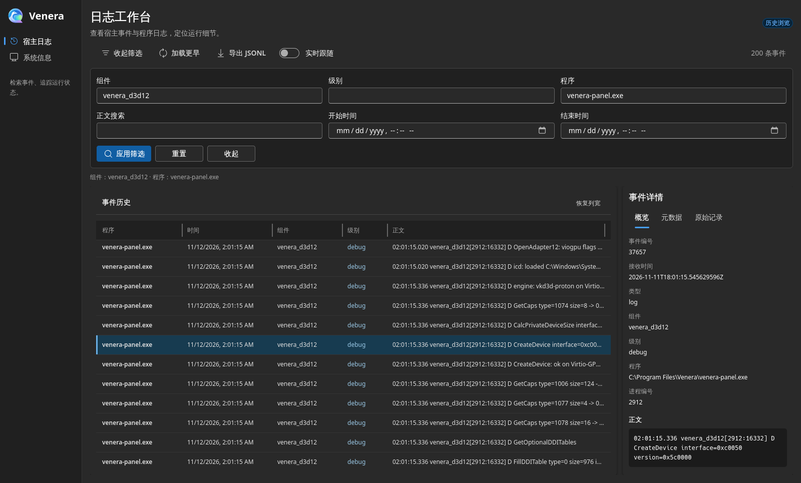
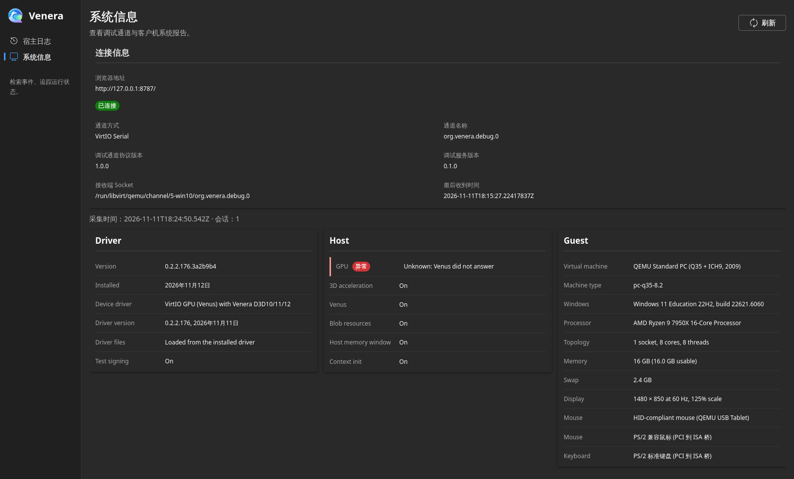

# Venera Host Debug Records

The host background process continuously receives records from the QEMU debug port, saving guest logs, effective filters, connection changes, and channel diagnostics. History is stored in SQLite in reception order, with the oldest records evicted when capacity reaches the budget. Log levels retain both the original and normalized values supplied by the collector.

## Build and Run

```sh
nix develop -c scripts/build workbench
```

QEMU provides a Unix socket listener for the dedicated virtserialport. The background process connects to that path and continuously reconnects:

```sh
build/debug-channel/release/venera-debug-host receive \
  --socket /run/user/1000/venera-debug.sock \
  --control /run/user/1000/venera-control.sock \
  --database /home/user/.local/share/venera/history.db \
  --max-bytes 1073741824
```

Create the example history directory first, and replace the paths with actual paths for the current user. `receive` runs continuously and can be managed by `systemd --user`. On each connection, the background process sends an endpoint introduction and a status query.

`--max-bytes` is the total capacity budget for the history store and SQLite workspace, with a minimum of 65536 bytes. Transaction workspace is reserved, and history uses the remaining capacity. The oldest history records are evicted in batches, and database pages are reclaimed on commit. Storage errors are reported through background runtime diagnostics.

## User Service Deployment

Run from the repository root and choose an accessible QEMU socket path. These commands install the build artifact in the user's program directory and render the startup command in the service template:

```sh
nix develop -c scripts/build workbench
install -Dm755 build/debug-channel/release/venera-debug-host "$HOME/.local/bin/venera-debug-host"
mkdir -p "$HOME/.local/share/venera" "$XDG_RUNTIME_DIR/venera"
python3 scripts/venera-debug-host-service \
  --binary "$HOME/.local/bin/venera-debug-host" \
  --socket "$XDG_RUNTIME_DIR/venera/debug.sock" \
  --control "$XDG_RUNTIME_DIR/venera/control.sock" \
  --database "$HOME/.local/share/venera/history.db" \
  --max-bytes 1073741824 \
  --output "$HOME/.config/systemd/user/venera-debug-host.service"
systemd-analyze --user verify "$HOME/.config/systemd/user/venera-debug-host.service"
systemctl --user daemon-reload
systemctl --user enable --now venera-debug-host.service
systemctl --user status venera-debug-host.service
journalctl --user -u venera-debug-host.service -f
```

The template is `debug-channel/host/systemd/venera-debug-host.service.in`. The script accepts installed absolute paths and converts them to systemd argument syntax. The user service manager restarts the service after runtime failures. The service manager creates the `$XDG_RUNTIME_DIR/venera` runtime directory. If QEMU uses a persistent directory, replace `--socket` and `--control` with paths in that directory.

```sh
systemctl --user stop venera-debug-host.service
systemctl --user start venera-debug-host.service
"$HOME/.local/bin/venera-debug-host" status --control "$XDG_RUNTIME_DIR/venera/control.sock"
```

Stopping the service causes the service manager to send a termination signal. Committed history remains available on the next start. The user service follows the user service manager's lifecycle; for deployments that need continuous operation after boot, an administrator can configure lingering for that user.

## QEMU and libvirt Ports

Example QEMU arguments, using the bus name of an existing virtio-serial controller in the VM:

```sh
-chardev socket,id=venera-debug,path=/run/user/1000/venera/debug.sock,server=on,wait=off \
-device virtserialport,bus=virtio-serial0.0,chardev=venera-debug,name=org.venera.debug.0
```

For a libvirt VM, append this channel to the existing `<devices>`. Its path should match the host `--socket` and be accessible to both the QEMU runtime user and the host background user:

```xml
<channel type='unix'>
  <source mode='bind' path='/run/user/1000/venera/debug.sock'/>
  <target type='virtio' name='org.venera.debug.0'/>
</channel>
```

libvirt's `bind` mode creates a listening socket; after startup QEMU waits for the background process to connect. The corresponding command-line form is `server=on,wait=off`. Existing SPICE channels and other devices remain alongside the new channel, and libvirt allocates an available virtio-serial port. System libvirt commonly uses domain-specific directories under `/var/lib/libvirt/qemu/channel/target/`. Configure the actual socket directory and permissions for the current domain's runtime user. After saving the domain configuration, enable the port during the planned VM restart.

## Queries and Filters

```sh
venera-debug-host status --control /run/user/1000/venera-control.sock
venera-debug-host filter-set --control /run/user/1000/venera-control.sock \
  --filter '{"components":["dxvk"],"levels":["warning","error"],"targets":[]}' \
  --duration-ms 60000
venera-debug-host filter-reset --control /run/user/1000/venera-control.sock
```

Commands submit requests to the continuously running background process, which forwards them to the guest and returns the corresponding response. The effective filter, revision, expiration time, and forwarding state in the response come from the guest. `status` queries the current effective state.

Filters select already-produced records. Component, level, and target dimensions are intersected, while values within each dimension are unioned. An empty array matches all values in that dimension. All three arrays are empty in the default filter. Targets support process instances and full executable paths.

## Save and Export

```sh
venera-debug-host export --database /home/user/.local/share/venera/history.db \
  > session.jsonl
```

Select an export range by host reception time:

```sh
venera-debug-host export --database /home/user/.local/share/venera/history.db \
  --from 2026-11-10T08:00:00Z --until 2026-11-10T09:00:00Z \
  > session-hour.jsonl
```

`--from` includes the start; `--until` stops before the end. Either can be used alone. Times use RFC3339, supporting fractional seconds and timezone offsets, and are compared by their corresponding UTC instants. The range applies to log, status, connection, and gap records using host `received_at`. When both arguments are provided, the start should precede the end. By default, all current history is exported.

Export generates JSON line by line. Each line contains host reception time in UTC as `received_at` and the original message object as `message`, preserving additional message fields. Export determines the end position at startup and reads the history still retained at that point in reception order. The background process continues receiving and evicting during export; history evicted before it is read is skipped. Storage IDs increase persistently, and the export cutoff identifies the history batch at startup. To preserve a complete current history batch, stop the service before exporting. User-saved files are maintained independently of the background history capacity.

## Browser Log Workbench

The workbench provides history browsing, live following, full-text search, and record details. Filter history by component, message level, program path or PID, and reception-time range, then export records matching the current conditions as JSONL. Record details show the complete text, program information, and original record.

Build the host program and frontend:

```sh
# Run from the repository root
nix develop -c scripts/build workbench
```

After starting the workbench, open <http://127.0.0.1:8787> in a browser:

```sh
build/debug-channel/release/venera-debug-host web \
  --database .harness/vm-debug/live.sqlite \
  --control .harness/vm-debug/host-control.sock \
  --assets debug-channel/web/dist
```

Replace `--database` with the history store path used by the receiver background process. The existing `receive` background process continues saving new records, and the workbench displays the same history. With live following enabled, new records append to the list; load earlier records to browse backward. Page filters help explore saved records, while the debug channel settings in the Windows control panel manage collection and forwarding.

Expand the toolbar filter panel to adjust conditions alongside the event list. Header separators adjust column widths; the separator between the list and details adjusts the detail area width. Separators also support arrow keys. The Overview, Metadata, and Raw record detail views show text and program information, complete fields, and copyable original content, respectively; content areas support scrolling.

The sidebar's System information queries the current connection and Windows system report through the receiver background process specified by `--control`. The control path should match `receive --control`. The connection card shows the actually negotiated debug channel protocol version and debug service version. The report follows Venera Panel's sections, showing drivers, graphics host, guest, graphics APIs, video memory, and settings, with collection time and session. A progress indicator appears during collection. Refresh retains the current report, then updates its content and time on completion.





## Venera protocol v1

Host and guest exchange UTF-8 JSONL over VirtIO Serial. Each line is a JSON-RPC 2.0 message; public interface documents use OpenRPC 1.4.1. Methods include `status.get`, `filter.set`, `filter.reset`, `system.info.get`, `rpc.discover`, `status.changed`, `log`, and `gap`.

`rpc.discover` returns the current endpoint's OpenRPC document. Requests use string IDs and named parameter objects, results carry the same ID, and notifications directly carry method names and parameters. Sequence numbers, revisions, counts, durations in milliseconds, and FILETIME use DecimalU64 strings; PIDs, thread IDs, and session IDs use JSON integers. See [Venera protocol v1](venera-protocol-v1.md) for receivers, data representation, and validation commands.

Protocol documents are generated from shared Rust types. Generate and check them with:

```bash
nix develop -c cargo run --locked --manifest-path debug-channel/Cargo.toml -p venera-debug-protocol --example generate-v1 --features schema
nix develop -c scripts/build check
```

The host background process parses JSON-RPC messages into log, status, connection, and gap records, continuously writing them to SQLite. The browser workbench reads the same history through application interfaces and provides live browsing, filters, details, and JSONL export.

## Validation

```sh
nix develop -c scripts/build check
```

This entry point uses Nix-provided Python `jsonschema` to validate both sets of Schemas, checks generated protocol documents and service deployment, and runs frontend type checking, tests, linting, and builds. Rust workspace tests enable host Web and protocol Schema features, covering byte splitting, recovery from malformed lines, filter matching, and real Unix sockets, CLI controls, reconnects, restarts, SQLite eviction, and export.
