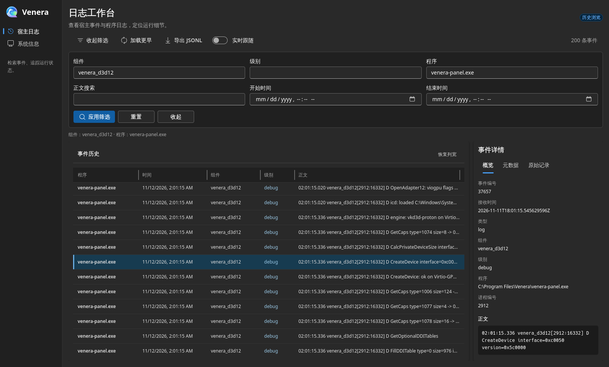
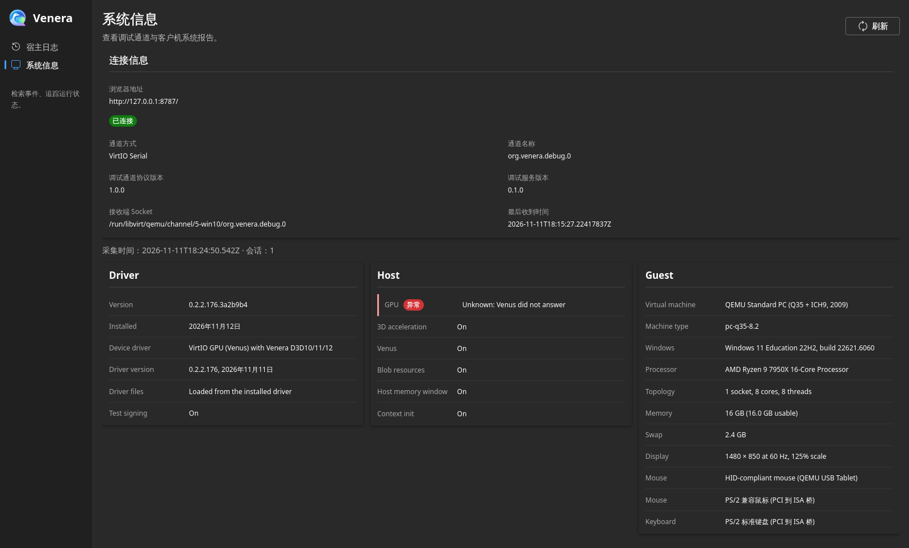

# Venera Host Debug History

The host service connects to a Windows guest over VirtIO sockets, saving guest logs, effective filters, connection changes, and channel diagnostics. SQLite stores history in reception order and evicts the oldest records when the capacity budget is reached. The same service provides the browser workbench and command-line controls.

## Build and Run

From the repository, list the guests visible on the local libvirt system connection, then start collecting from one by name:

```sh
nix run .#venera-debug-host -- list
nix run .#venera-debug-host -- serve Windows10
```

Open <http://127.0.0.1:8787>. `list` shows each guest’s name, state, and live vsock CID when available. `serve 73` selects the guest named `73`. To connect by CID directly, choose the history database explicitly:

```sh
venera-debug-host serve --cid 73 --database ./history.db
```

When serving by name, the host tracks the domain UUID and refreshes its live CID whenever the control or history stream reconnects. The default database is `$XDG_DATA_HOME/venera/<domain-uuid>/history.db` (`XDG_DATA_HOME` defaults to `~/.local/share`). Renaming the guest preserves its archive.

The service defaults to a 1 GiB history budget, guest port `49152`, and control socket `$XDG_RUNTIME_DIR/venera/control.sock` (runtime directory fallback: `/run/user/<uid>`). The host creates the directories for its default paths. Use `--database`, `--max-bytes`, `--port`, `--control`, and `--listen` to customize a deployment. Give concurrent services separate control sockets and listen addresses.

The dashboard loads from `../share/venera/web` relative to the executable directory, or from `debug-channel/web/dist` for a source build (`nix develop -c scripts/build workbench`). Use `--assets DIR` to choose another frontend or `--no-web` for collection alone.

`--max-bytes` is the total capacity budget for the history database and SQLite workspace, with a minimum of 73784 bytes. Transaction workspace is reserved within it, and history data uses the remaining capacity. History is evicted in batches starting with the oldest records, and database pages are reclaimed on commit. Archive reads adapt their page size to the available capacity and resume from committed progress. Connection status includes archive progress and diagnostic-write status.

## User Service Deployment

Run from the repository root. These commands install the compiled program and browser assets and render the startup command in the service template:

```sh
nix develop -c scripts/build workbench
install -Dm755 build/debug-channel/release/venera-debug-host "$HOME/.local/bin/venera-debug-host"
mkdir -p "$HOME/.local/share/venera/web" "$XDG_RUNTIME_DIR/venera"
cp -R debug-channel/web/dist/. "$HOME/.local/share/venera/web/"
python3 scripts/venera-debug-host-service \
  --binary "$HOME/.local/bin/venera-debug-host" \
  --cid 73 --port 49152 \
  --control "$XDG_RUNTIME_DIR/venera/control.sock" \
  --database "$HOME/.local/share/venera/history.db" \
  --max-bytes 1073741824 \
  --assets "$HOME/.local/share/venera/web" \
  --listen 127.0.0.1:8787 \
  --output "$HOME/.config/systemd/user/venera-debug-host.service"
systemd-analyze --user verify "$HOME/.config/systemd/user/venera-debug-host.service"
systemctl --user daemon-reload
systemctl --user enable --now venera-debug-host.service
systemctl --user status venera-debug-host.service
journalctl --user -u venera-debug-host.service -f
```

The template is at `debug-channel/host/systemd/venera-debug-host.service.in`. The script accepts installed absolute paths. The user service manager restarts the service after runtime failures and creates the `$XDG_RUNTIME_DIR/venera` runtime directory. The Unix control socket at `--control` serves local command-line requests. The generator also accepts `--no-web` for collection deployments.

```sh
systemctl --user stop venera-debug-host.service
systemctl --user start venera-debug-host.service
"$HOME/.local/bin/venera-debug-host" status --control "$XDG_RUNTIME_DIR/venera/control.sock"
```

Stopping the service sends a termination signal through the service manager. Committed history remains available on the next startup. The user service follows the user service manager's lifecycle; administrators can enable lingering for users whose deployments need continuous operation after boot.

## QEMU and libvirt Guest Address

Add a VirtIO socket device with a deployment-specific guest CID above 2. For QEMU directly:

```sh
-device vhost-vsock-pci,guest-cid=73
```

For libvirt, add this device within `<devices>`:

```xml
<vsock model='virtio'>
  <cid auto='no' address='73'/>
</vsock>
```

Allocate distinct CIDs across running guests and match the host's `--cid` to the chosen VM. Linux supplies the AF_VSOCK client; Windows listens through the official viosock Winsock provider on port 49152. The host needs kernel VirtIO socket support, and QEMU needs access to `/dev/vhost-vsock`. Save the device in the persistent VM configuration and activate it during deployment. Independent host peers have separate streams and queues; they share the guest's reception filter, with the latest applied change determining its revision.

## Queries and Filters

```sh
venera-debug-host status
venera-debug-host filter-set \
  --filter '{"components":["dxvk"],"levels":["warning","error"],"targets":[]}' \
  --duration-ms 60000
venera-debug-host filter-reset
```

Commands submit requests to the continuously running background process, which forwards them to the guest and returns the corresponding response. The effective filter, revision, expiration time, and forwarding state in the response come from the guest. `status` queries the current effective state.

Filters select already-produced records. The component, level, and target dimensions are intersected, while entries within one dimension are unioned. An empty array matches all values in that dimension. All three arrays in the default filter are empty. Targets support process instances and full executable paths.

## History Export

```sh
venera-debug-host export --database /home/user/.local/share/venera/history.db \
  > session.jsonl
```

Select an export range by host reception time:

```sh
venera-debug-host export --database /home/user/.local/share/venera/history.db \
  --from 2026-11-10T08:00:00Z --until 2026-11-10T09:00:00Z \
  > session-hour.jsonl
```

`--from` includes the start instant, and `--until` stops before the end instant. Either can be used independently. Times use RFC3339, supporting fractional seconds and time-zone offsets, and are compared by their corresponding UTC instants. The range applies to log, status, connection, and gap records using host `received_at`. When both arguments are supplied, the start should precede the end. By default, all current history is exported.

Export produces one JSON object per line, containing the host reception UTC time `received_at` and the original message object `message`, including additional message fields. The end position is fixed when export starts. Records still retained from that history are read individually in reception order. The background process continues receiving and evicting during export; records evicted before they are read are skipped. Storage IDs increase persistently, and the export cutoff identifies the history batch present at the start. To preserve a current history batch in full, stop the service before exporting. User-saved files are independent of the background history capacity management.

## Browser Log Workbench

The workbench provides history browsing, live following, full-text search, and record details. Filter history by component, message level, program path or PID, and reception-time range, then export matching records as JSONL. Record details show complete text, program information, and the original record.

Collection and the browser workbench share one service lifecycle and database. Enabling live following appends new records to the list; loading earlier records lets you browse backward. Page filters explore saved records, while debug channel settings in the Windows control panel manage collection and forwarding. The browser language selector offers System, English, and Simplified Chinese, applies changes immediately, and remembers the preference.

Expand the toolbar's filter panel to adjust conditions alongside the event list. Header dividers resize columns, and the divider between the list and details resizes the details area; dividers also support arrow-key operation. The “Overview,” “Metadata,” and “Raw record” detail tabs show text and program information, complete fields, and copyable original content, respectively, with scrollable content areas.

The sidebar's “System information” queries the service's current connection and Windows system report. The connection card shows the negotiated debug-channel protocol version and debug-service version. The report follows Venera Panel's sections for drivers, graphics host, guest, graphics APIs, video memory, and settings, and identifies the collection time and session. A progress indicator appears during collection; refresh preserves the current report until completion, then updates the content and time. Report presentation uses localized labels alongside the original diagnostic values.





## Venera Protocol v1

The host and guest exchange UTF-8 JSONL over VirtIO sockets using application protocol 1.0.0. Each line is a JSON-RPC 2.0 message, and public interface documents use OpenRPC 1.4.1. Methods include `status.get`, `filter.set`, `filter.reset`, `system.info.get`, `rpc.discover`, `status.changed`, `log`, and `gap`.

`rpc.discover` returns the current endpoint's OpenRPC document. Requests use string IDs and named parameter objects, results carry the same ID, and notifications carry the method name and parameters directly. Sequence numbers, revisions, counts, durations in milliseconds, and FILETIME values use DecimalU64 strings; PIDs, thread IDs, and session IDs use JSON integers. See [Venera protocol v1](venera-protocol-v1.md) for receivers, data representations, and validation commands.

Protocol documents are generated from shared Rust types. Generate and check them with:

```bash
nix develop -c cargo run --locked --manifest-path debug-channel/Cargo.toml -p venera-debug-protocol --example generate-v1 --features schema
nix develop -c scripts/build check
```

The host background process parses JSON-RPC messages into log, status, connection, and gap records and continuously writes them to SQLite. The browser workbench reads the same history through application interfaces and provides live browsing, filtering, details, and JSONL export.

## Validation

```sh
nix develop -c scripts/build check
```

This entry point uses Nix-provided Python `jsonschema` to validate both sets of Schemas, checks generated protocol documents and service deployment, and runs frontend type checking, tests, linting, and builds. Rust workspace tests enable host Web and protocol Schema features, covering byte splitting, recovery after malformed lines, filter matching, and real Unix sockets, CLI control, reconnection, restart, SQLite eviction, and export.
